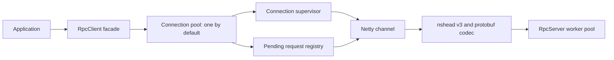

# SDK-managed persistent connections and multiplexing

Status: proposal for review. This document describes the next SDK iteration; the proposed builder and state APIs are not implemented yet.

## Assessment of the current implementation

`rpc-sdk` already contains the wire codec, heartbeat, reconnect loop, request ID allocation, pending-call map, and typed `RpcClient.call(...)`. The classes in `rpc-example` only demonstrate those capabilities. The proposed work makes the SDK contract easier to use and makes connection behavior explicit and testable.

The current client exposes a positional configuration record, creates an event loop group per client, and spreads pending-call cleanup across response, timeout, write failure, disconnect, and close paths. It has no readiness future or connection-state listener. Completing a `CompletableFuture` on the Netty event loop can execute a caller's synchronous continuation on that loop.

## Public contract

Applications create one long-lived `RpcClient` per remote endpoint and share it across threads. The default uses one persistent TCP connection; every call on that connection is multiplexed. The application supplies its protobuf messages, method descriptor, endpoint, and provider name. It does not allocate request IDs, send heartbeats, schedule reconnects, or maintain a response map.

Proposed single-endpoint API:

```java
RpcClient client = RpcClient.builder(new InetSocketAddress("127.0.0.1", 9080), "order-service")
        .requestTimeout(Duration.ofSeconds(3))
        .connectionCount(1)
        .connect(); // Wait for the first connection; reconnect automatically after later failures.

CompletableFuture<EchoResponse> reply = client.call(EchoRpc.ECHO,
        EchoRequest.newBuilder().setMessage("hello").build());

// Keep the client for later calls and close it during application shutdown.
```

`connect()` makes an initial connection attempt, waits up to the configured connect timeout for at least one ready connection, and closes the new client if the attempt fails. After successful startup, it reconnects automatically after later failures. Additional configured connections start asynchronously. `open()` on the same builder returns immediately and keeps retrying when the server is unavailable. Each call to `client.ready()` returns a future that completes when at least one connection is ready, including after a later reconnect. `client.state()` and `client.stats()` expose snapshots for health checks and diagnostics. The existing static `RpcClient.connect(...)`, `RpcClient.open(...)`, `request(...)`, and `call(...)` methods remain available and delegate to the same implementation.

The builder adds named settings for request timeout, connect timeout, heartbeat idle time, PONG timeout, reconnect backoff, maximum body length, maximum in-flight calls per connection, connection count, I/O thread count, and completion executor. Existing defaults remain: 3-second connect timeout, 30-second idle before PING, 10-second PONG timeout, 500 ms to 30-second reconnect backoff with jitter, and 4,096 in-flight calls per connection. The default I/O thread count is the smaller of the connection count and available processors.

`RpcServer.register(RpcMethodDescriptor, handler)` remains the server entry point. The server continues to run application handlers on its bounded worker pool and echo the request ID in each response. An optional server builder can replace positional constructors without changing the handler contract.

## Internal components



- `RpcClient` owns the public lifecycle and typed call API. One client instance owns one Netty event loop group, sized for its connections and shared by them.
- `ConnectionSupervisor` owns each channel's `DISCONNECTED -> CONNECTING -> READY -> BACKOFF` transitions, heartbeat, reconnect timer, and close handling. `CLOSED` is terminal. Only one connect attempt and one reconnect timer may exist per channel.
- `RpcConnection` owns a Netty channel and its pending-request registry. A replacement channel gets a new connection generation. The overall client is ready when at least one channel is ready.
- `RpcClient` allocates nonzero 64-bit request IDs across its connections. `PendingRequestRegistry` reserves capacity, stores the parser and deadline, and performs exactly-once terminal cleanup. Terminal paths are response, timeout, write failure, cancellation, disconnect, and client close.
- The existing codec keeps the 44-byte little-endian nshead v3 header and protobuf response envelope. No wire-format revision is proposed.

When `connectionCount` is greater than one, the SDK selects a ready channel with the fewest in-flight calls. Each channel remains independently multiplexed. With the default count of one, concurrent calls use the same TCP connection and can complete out of order.

## Call and failure behavior

1. Validate the method descriptor and serialize the request. Select a ready channel and reserve one in-flight slot. A disconnected or saturated client returns a failed future immediately.
2. Register the pending call before writing its nshead frame. The frame carries the 64-bit request ID in the header. Start the request deadline when the call is accepted.
3. Match a response by connection generation and header request ID. Validate method ID and log ID, decode the response, release capacity, and complete the future. Late replies after timeout or cancellation are discarded and counted.
4. PING is sent after read idle; only a matching PONG clears its heartbeat deadline. A missing PONG closes the channel and starts reconnect backoff.
5. On disconnect, fail all calls pending on that channel with an outcome-unknown transport error. The SDK does not replay them because the server may already have executed them. Calls made while all channels are down fail fast. New calls work after a connection returns.
6. Completing user futures is dispatched through a configurable completion executor so synchronous `CompletableFuture` continuations cannot block a Netty I/O loop. The default uses a shared executor. Application handlers on the server remain on server workers.
7. `close()` rejects new calls, cancels reconnect and heartbeat tasks, fails pending calls once, closes channels, and releases event loop resources.

The SDK exposes distinct failure categories for unavailable connection, deadline exceeded, local in-flight limit, remote overload (`error_code=4`), protocol error, and disconnect with unknown execution outcome. Business code can handle these through the returned future. Automatic business-call retries are outside the default behavior; a caller can retry only when its operation is safe to repeat.

## Observability

`client.stats()` reports ready connection count, in-flight calls, reconnect attempts, heartbeat timeouts, request timeouts, and discarded late responses. State-change callbacks report connection ID, local and remote addresses, and the transition reason. Request logs retain request ID and connection ID so an application can verify that multiple calls used one TCP connection. Metrics integration remains optional; the SDK does not require a specific metrics library.

## Delivery and verification

1. Add the builder and readiness/state APIs while keeping existing entry points compatible. Move connection supervision and pending-call cleanup behind `RpcClient`.
2. Add the configurable connection count and completion executor. Keep the default at one connection.
3. Update `rpc-example` so its long-connection and multiplexing examples only configure and call the SDK; neither example contains transport logic.
4. Verify out-of-order responses on one TCP connection, concurrent calls, heartbeat, reconnect after server restart, failure of in-flight calls on disconnect, timeout and late response handling, cancellation, capacity limits, and clean shutdown.
5. Repeat the separate-JVM benchmark under the same conditions recorded in `rpc-benchmark/RESULTS.md`. Investigate a material throughput or latency regression before replacing the current client implementation.

The principal design choices for review are the single-connection default, fail-fast calls while no connection is ready, no automatic replay of in-flight calls, and an optional connection count for higher throughput.
