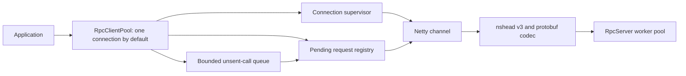

# SDK-managed connection pool and multiplexing

Status: proposal for review. This document describes the next SDK iteration; the proposed builder and state APIs are not implemented yet.

## Assessment of the current implementation

`rpc-sdk` already contains the wire codec, heartbeat, reconnect loop, request ID allocation, pending-call map, and typed `RpcClient.call(...)`. The classes in `rpc-example` only demonstrate those capabilities. The proposed work gives applications one pool-shaped SDK entry point and makes connection behavior explicit and testable.

The current client exposes a positional configuration record, creates an event loop group per client, and spreads pending-call cleanup across response, timeout, write failure, disconnect, and close paths. It has no readiness future or connection-state listener. Completing a `CompletableFuture` on the Netty event loop can execute a caller's synchronous continuation on that loop.

## Public contract

Applications create one long-lived `RpcClientPool` per remote endpoint and share it across threads. The pool manages persistent TCP connections and their Netty I/O thread pool. Connection count and I/O thread count are separate settings; concurrent RPC calls do not consume one thread each. The default uses one connection and one I/O thread; every call on that connection is multiplexed. The application supplies its protobuf messages, method descriptor, endpoint, and provider name. It does not allocate request IDs, send heartbeats, schedule reconnects, or maintain a response map.

Proposed single-endpoint API:

```java
RpcClientPool pool = RpcClientPool.builder(new InetSocketAddress("127.0.0.1", 9080), "order-service")
        .responseTimeout(Duration.ofSeconds(3))
        .connections(1)
        .maxReconnectAttempts(3)
        .connectionWaitTimeout(Duration.ofSeconds(15))
        .build(); // Starts connection attempts in the background.

CompletableFuture<EchoResponse> reply = pool.call(EchoRpc.ECHO,
        EchoRequest.newBuilder().setMessage("hello").build());

// Keep the pool for later calls and close it during application shutdown.
```

`build()` starts connection attempts asynchronously. A call made before the first connection is ready can wait in the bounded SDK queue. Each call to `pool.ready()` returns a future that completes when at least one connection is ready or fails when the reconnect threshold is reached; a later call can wait for recovery. `pool.state()` and `pool.stats()` expose snapshots for health checks and diagnostics. Existing `RpcClient` entry points retain their current fail-fast behavior while sharing the refactored transport components; new integrations use `RpcClientPool` for bounded reconnect waiting.

The builder adds named settings for response timeout, per-dial connect timeout, connection wait timeout, maximum reconnect attempts, queued-call count and byte limits, heartbeat idle time, PONG timeout, reconnect backoff, maximum body length, maximum in-flight calls per connection, connection count, I/O thread count, and completion executor. Proposed defaults are three failed reconnect cycles, a 1,024-call and 16 MiB unsent queue, 15-second connection wait timeout, 3-second response timeout, 3-second per-dial connect timeout, 30-second idle before PING, 10-second PONG timeout, 500 ms to 30-second reconnect backoff with jitter, and 4,096 in-flight calls per connection. The default I/O thread count is the smaller of the connection count and available processors.

`RpcServer.register(RpcMethodDescriptor, handler)` remains the server entry point. The server continues to run application handlers on its bounded worker pool and echo the request ID in each response. An optional server builder can replace positional constructors without changing the handler contract.

## Internal components



- `RpcClientPool` owns the public lifecycle and typed call API. One pool owns a Netty event loop group, sized for its connections and shared by them. It also owns a bounded queue for calls that have not been written to a channel.
- `ConnectionSupervisor` owns each channel's `DISCONNECTED -> CONNECTING -> READY -> BACKOFF` transitions, heartbeat, reconnect timer, and close handling. `CLOSED` is terminal. Only one connect attempt and one reconnect timer may exist per channel. When all channels are down, one pool-level reconnect cycle tries to restore at least one; a cycle with no ready channel counts as one failed attempt.
- `RpcConnection` owns a Netty channel and its pending-request registry. A replacement channel gets a new connection generation. The pool is ready when at least one channel is ready.
- `RpcClientPool` allocates nonzero 64-bit request IDs across its connections. `PendingRequestRegistry` reserves capacity, stores the parser and deadline, and performs exactly-once terminal cleanup. Terminal paths are response, timeout, write failure, cancellation, disconnect, and pool close.
- The existing codec keeps the 44-byte little-endian nshead v3 header and protobuf response envelope. No wire-format revision is proposed.

When `connectionCount` is greater than one, the SDK selects a ready channel with the fewest in-flight calls. Each channel remains independently multiplexed. With the default count of one, concurrent calls use the same TCP connection and can complete out of order.

`pool.state()` returns `STARTING` before the first dial, `READY` when the target number of connections is ready, `DEGRADED` when at least one but fewer than the target is ready, `RECONNECTING` when none is ready and the failure threshold is not reached, `UNAVAILABLE` after the threshold, and `CLOSED` after shutdown. A successful connection resets the consecutive failure count.

## Call and failure behavior

1. Validate the method descriptor and serialize the request. If a channel is ready, reserve an in-flight slot, register the pending call, and write its nshead frame with a 64-bit header request ID. The 3-second response timer starts when the call is sent. If every ready channel is at its in-flight limit, return a local overload error immediately.
2. If all channels are unavailable and the reconnect failure threshold has not been reached, place the **unsent** call in a FIFO queue and ensure a reconnect cycle is running. Admission requires both a free queue slot and enough remaining queue bytes. The 15-second connection wait timer starts when the call enters the queue. Queue overflow returns a failed future immediately.
3. When any channel becomes ready, drain queued calls into available in-flight slots. Cancellation or wait timeout removes an unsent call and releases its queue capacity. An unsent call may be sent once after reconnection because it was never written to the failed channel.
4. After three consecutive pool-level reconnect cycles fail while all channels are down, fail every queued call with `ConnectionUnavailableException` and set the pool state to `UNAVAILABLE`. New calls fail immediately in this state. The SDK continues background reconnect attempts with capped backoff; the first successful connection resets the failure count and restores normal calls.
5. Match a response by connection generation and header request ID. Validate method ID and log ID, decode the response, release in-flight capacity, and complete the future. Late replies after timeout or cancellation are discarded and counted.
6. PING is sent after read idle; only a matching PONG clears its heartbeat deadline. A missing PONG closes the channel and starts reconnect backoff. Calls already written on that channel fail immediately with an outcome-unknown transport error. They are never replayed because the server may already have executed them.
7. Completing user futures is dispatched through a configurable completion executor so synchronous `CompletableFuture` continuations cannot block a Netty I/O loop. The default uses a shared executor. Application handlers on the server remain on server workers.
8. `close()` rejects new calls, cancels reconnect and heartbeat tasks, fails queued and in-flight calls once, closes channels, and releases event loop resources.

The response timeout starts after a call is sent. A call accepted while disconnected can wait up to 15 seconds for a connection and then up to 3 seconds for its response; the reconnect failure threshold can end the wait sooner. The SDK exposes distinct failure categories for unavailable connection, connection wait timeout, response timeout, local queue or in-flight limit, remote overload (`error_code=4`), protocol error, and disconnect with unknown execution outcome. Business code handles them through the returned future. The SDK does not automatically replay a call that may have reached the server.

## Observability

`pool.stats()` reports ready connection count, queued calls and bytes, in-flight calls, consecutive failed reconnect cycles, heartbeat timeouts, connection wait timeouts, response timeouts, and discarded late responses. State-change callbacks report connection ID, local and remote addresses, and the transition reason. Request logs retain request ID and connection ID so an application can verify that multiple calls used one TCP connection. Metrics integration remains optional; the SDK does not require a specific metrics library.

## Delivery and verification

1. Add `RpcClientPool` with a builder, readiness/state APIs, a bounded unsent-call queue, and connection supervision. Preserve the existing `RpcClient` API and its fail-fast behavior using shared lower-level transport components.
2. Add configurable connection and I/O thread counts, reconnect failure threshold, and completion executor. Keep the default at one connection.
3. Update `rpc-example` so its long-connection and multiplexing examples only configure and call the SDK; neither example contains transport logic.
4. Verify out-of-order responses on one TCP connection, concurrent calls, heartbeat, reconnect after server restart, queued calls sent once after reconnect, threshold failure and later recovery, failure of in-flight calls on disconnect, both timeout types, late responses, cancellation, both capacity limits, and clean shutdown.
5. Repeat the separate-JVM benchmark under the same conditions recorded in `rpc-benchmark/RESULTS.md`. Investigate a material throughput or latency regression before replacing the current client implementation.

The principal design choices for review are the `RpcClientPool` name, one connection by default, three failed reconnect cycles before queued calls fail, immediate failure of new calls while the pool is `UNAVAILABLE`, and continued background reconnect so a recovered server can accept later calls.
